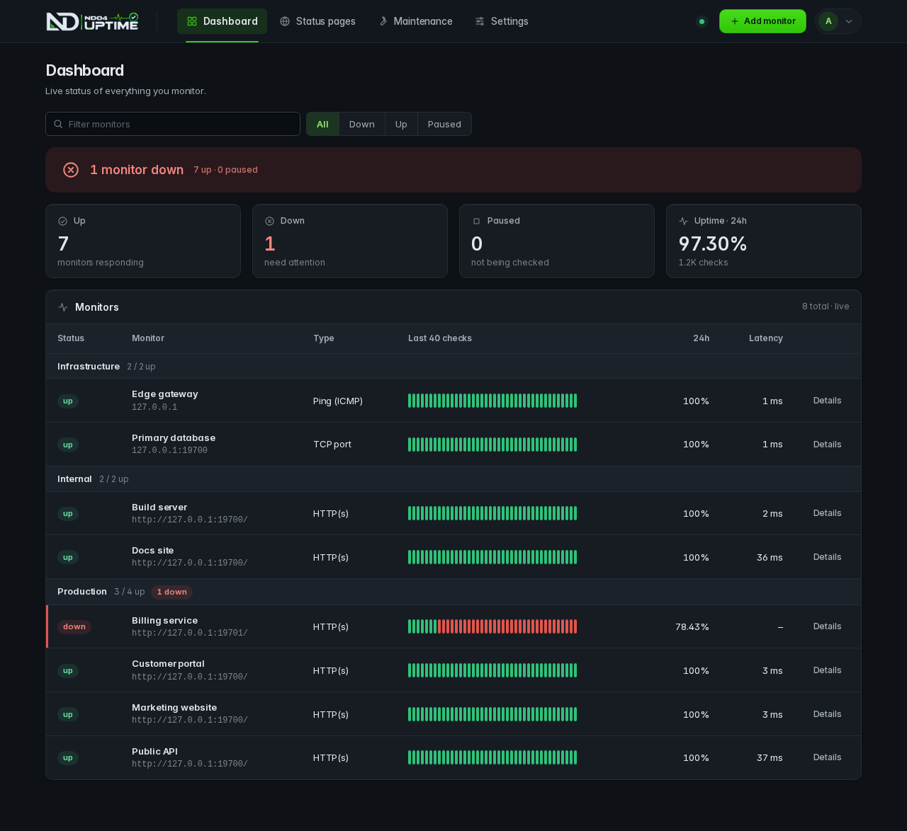

<div align="center">


# NDO4Uptime

**A lightweight, security-focused uptime monitor written in Rust.**<br>
One container. Small static binary. Webhook alerts. Secure by default.

[](https://github.com/NDO4ME/ndo4uptime-bot/actions/workflows/ci.yml)
[](https://github.com/NDO4ME/ndo4uptime-bot/actions/workflows/docker-publish.yml)
[](LICENSE)

[Quick start](#quick-start) · [Features](#why-ndo4uptime) · [Updating](DEVELOPER.md#updating) · [Documentation](DEVELOPER.md)



</div>

## Why NDO4Uptime

| | |
|---|---|
| **Four check types** | HTTP(s), Browser, TCP port and ICMP ping. HTTP supports method, custom headers, body, expected status ranges, keyword match, redirects, TLS verification and a per-monitor proxy. [Details](DEVELOPER.md#monitor-types) |
| **Browser check without Chromium** | A pure-Rust page load: the HTML is parsed with Servo's `html5ever`, then CSS, scripts and images are fetched like a browser would. Fails on broken assets, missing text or a missing CSS selector. [How it works](DEVELOPER.md#browser-checks) |
| **Certificate expiry** | HTTPS monitors track the certificate's expiry date and can fail (and alert) before it lapses. |
| **Status pages** | Public pages for the monitors you choose, grouped your way, live without refresh, with an optional custom domain per page. Monitors can be grouped on the dashboard too. [Status pages](DEVELOPER.md#status-pages-and-cloudflare-tunnel) |
| **Cloudflare Tunnel** | Switch it on from Settings to publish status pages on your own subdomain, with no open ports. Only the public listener is exposed, never the admin panel. |
| **Tailscale** | Switch it on from Settings to monitor private services — tailnet devices and LANs behind a subnet router. Userspace mode (no root, no TUN, no extra privileges), shielded node, automatic verified updates with rollback. [Details](DEVELOPER.md#tailscale-monitor-private-networks) |
| **No false alarms** | A monitor turns yellow on the 1st and 2nd failed check and is declared down — and alerts — only on the 3rd consecutive failure. Configurable in Settings, overridable per monitor. [How it works](DEVELOPER.md#down-confirmation-no-false-alarms) |
| **Webhook alerts** | One focused channel: JSON `POST` on down and recovery, custom headers, optional HMAC-SHA256 signature and a test button. [Payload](DEVELOPER.md#webhooks) |
| **Extremely light** | Static Rust binary, SQLite storage, a `scratch` image with nothing else in it. No Node.js, no Chromium, no JavaScript engine. |
| **Secure by default** | Listens on localhost only, no default password (random one generated on first start), Argon2id passwords, CSRF protection, login rate limiting, strict CSP, read-only non-root container. [Security](DEVELOPER.md#security-notes) |
| **Clear history** | 24h / 7d / 30d uptime, response-time chart, per-check log and automatic retention. |
| **Works behind your proxy** | Ready for Caddy with automatic HTTPS, or run it locally. [Caddy setup](DEVELOPER.md#reverse-proxy-caddy) |

## Quick start

One command, no clone, no build (prebuilt image from GitHub Container Registry):

```bash
docker run -d --name ndo4uptime --restart unless-stopped \
  -p 127.0.0.1:8589:8589 -v ndo4uptime-data:/data \
  --read-only --tmpfs /tmp:size=8m --cap-drop ALL --security-opt no-new-privileges:true \
  --memory 384m --pids-limit 256 \
  --log-opt max-size=10m --log-opt max-file=3 \
  --sysctl net.ipv4.ping_group_range="0 2147483647" \
  -e NDO4_ADMIN_PASSWORD='choose-a-long-password' \
  ghcr.io/ndo4me/ndo4uptime-bot:latest
```

`NDO4_ADMIN_PASSWORD` (at least 10 characters) sets the password; drop the line to get a random one in `docker logs ndo4uptime`. To join your tailnet on first start, add `-e NDO4_TAILSCALE_AUTHKEY=tskey-auth-…` (Tailscale needs no extra privileges, devices or capabilities); you can also do it later from Settings.

Or with Compose (builds from source):

```bash
git clone https://github.com/NDO4ME/ndo4uptime-bot.git
cd ndo4uptime-bot
docker compose up -d --build
```

Open `http://127.0.0.1:8589` and sign in with your `NDO4_ADMIN_PASSWORD`, or the random one printed once in the log (`docker logs ndo4uptime`); change it under Settings. Sign-in is password-only (no username); the dashboard and monitor pages update live over a server-sent event stream, no refresh needed.
Put it behind Caddy for HTTPS with the ready-made [`deploy/Caddyfile`](deploy/Caddyfile).

## Highlights in 1.8

- **AI incident assistant (Groq, free tier)**: when a monitor is confirmed down, a model writes a neutral corporate-tone notice for your status pages and a short English analysis for your webhooks (`analysis` event, after the DOWN alert). Down only, never on recovery. Primary `qwen/qwen3.8-27b`, automatic fallback to `openai/gpt-oss-20b`. Private by default: names only, IPs/hosts/URLs are stripped before and after the model. Set `-e NDO4_GROQ_API_KEY=gsk_…` or paste the key in Settings; it is stored encrypted, never shown again, and changing it needs your password.

## Highlights in 1.7

- **Prometheus `/metrics`** with token auth (Settings), plain HTTP for use behind Caddy or over Tailscale.
- **Mute** a monitor: still checked and shown, no webhooks.
- **Maintenance windows**, one-off or repeating, announced only on status pages that include an affected monitor.
- **White-label status pages**: brand, logo, accent, light/dark/auto theme, links, footer, optional attribution removal, incident history.
- **Rolling storage limits**: retention days, per-monitor cap and a database size cap; oldest data is deleted first.

## Update

```bash
docker pull ghcr.io/ndo4me/ndo4uptime-bot:latest && docker rm -f ndo4uptime && <the same docker run command>
# or, with Compose:
git pull && docker compose up -d --build
```

Data lives in the `ndo4uptime-data` volume and is kept. See [Updating](DEVELOPER.md#updating) and [Backup and restore](DEVELOPER.md#backup-and-restore).

## Documentation

| Topic | |
|---|---|
| Installation and configuration | [Quick start](DEVELOPER.md#quick-start) · [Environment variables](DEVELOPER.md#configuration) |
| Using the panel | [Monitor types](DEVELOPER.md#monitor-types) · [Status pages and Cloudflare Tunnel](DEVELOPER.md#status-pages-and-cloudflare-tunnel) · [Webhooks](DEVELOPER.md#webhooks) |
| Operations | [Updating](DEVELOPER.md#updating) · [Caddy](DEVELOPER.md#reverse-proxy-caddy) · [Backup](DEVELOPER.md#backup-and-restore) · [Reset password](DEVELOPER.md#reset-the-password) · [Troubleshooting](DEVELOPER.md#troubleshooting) |
| Security | [Security notes](DEVELOPER.md#security-notes) · [Policy](SECURITY.md) |
| Contributing | [Architecture](DEVELOPER.md#architecture) · [Development](DEVELOPER.md#development) · [CI/CD](DEVELOPER.md#cicd) |

## License

MIT, see [LICENSE](LICENSE).
